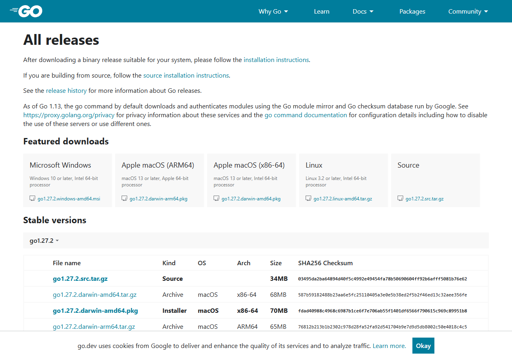

# Go 起步：装工具链，运行自己的程序

Go 不要求先学 C++。先认识三件事：VS Code 负责编辑，Go 工具链负责编译运行，Go 扩展提供编辑提示；只装扩展不能代替工具链。

先完成“安装 VS Code”的打开文件夹步骤，再按本篇操作。你可以直接学 Go，不必先完成 Web 环境。代码写进 `main.go`，命令输进 VS Code 底部终端；每条命令按一次 Enter，查看结果后再继续。

## 先选你现在的位置

第一次写代码，按“选安装包 → 安装 → 验证 → 初始化项目 → 写文件 → 运行”跟做。每一步都有可以观察的结果，结果不一致时先停下来排查。已有编程基础，可以先检查工具链和模块，再跳到运行；不需要重新安装正常工作的工具。

| 你现在看到什么 | 从哪里继续 | 这一段要拿到的结果 |
| --- | --- | --- |
| 电脑还没装 Go | [选安装包](../../index.html#/setup?topic=go&step=download)，再选自己的系统 | 下载文件名的系统、架构和后缀都正确 |
| Windows 的安装文件已经下载 | [Windows 安装向导](../../index.html#/setup?topic=go&step=windows) | 安装结束，新终端能执行 go version |
| Mac / Linux 的安装文件已经下载 | [macOS 安装](../../index.html#/setup?topic=go&step=mac) / [Linux 安装](../../index.html#/setup?topic=go&step=linux) | 工具链能用，命令路径能核对 |
| 装过 Go，但提示找不到命令 | [命令路径与 PATH 检查](../../index.html#/setup?topic=go&step=path) | 知道终端实际调用哪一份 Go |
| 能看到 Go 版本，还没运行自己的文件 | [在独立目录初始化](../../index.html#/setup?topic=go&step=module) | main.go 和 go.mod 属于同一个独立项目 |
| go run . 已成功，想设置断点 | [VS Code 项目配置](../../index.html#/setup?topic=editor&step=module) | 用 F5 停在自己的断点并观察变量 |

**这节会得到什么？** 一个你能修改、运行、重新编译的终端程序。它不生成网页，也不连接数据库。完成后再进入第1课学习语法和函数；安装成功只是准备好了工具。

## 1. 下载与验证 Go

### 先确认系统和处理器，别凭品牌猜

操作系统决定你下载 Windows、macOS 还是 Linux 文件；处理器架构决定选 amd64 还是 arm64。**amd64 是 x86-64 架构名，Intel 的普通 x64 电脑也选它**；arm64 是另一种架构。64位并不意味着两种包都能随便用。

- Windows：按 `Win+I` 打开设置 → 系统 → 关于（部分版本叫“系统信息”），找“系统类型”。写着“基于 x64 的处理器”选 amd64；写着“基于 ARM 的处理器”选 arm64。这里的 Win 是键盘上的 Windows 徽标键。
- macOS：苹果菜单 → 关于本机。芯片是 Apple M 系列选 arm64；处理器写 Intel 选 amd64。
- Linux：在终端输入 `uname -m` 查看架构。常见的 `x86_64` 对应 amd64，`aarch64` 对应 arm64。若输出不同，按官方下载表查找，不强行套用这两个名字。

已有 Go 环境时先执行 `go version` 检查；正常且符合练习要求可以跳到第3节。初次安装的人打开 [Go 官方下载页](https://go.dev/dl/)，找到 **Featured downloads（推荐下载）** 或 **Stable versions（稳定版本）**。版本会更新，本教程按文件名的组成来选，实际下载页的版本和系统要求为准。[Go 支持的系统要求](https://go.dev/wiki/MinimumRequirements)



图中从左到右是 Windows、Apple 芯片 Mac、Intel Mac、Linux 和 Source。**点击系统对应栏里的安装文件名**，不是 Source，也不是要求每栏都下载。Windows ARM64 等包可能不在推荐区，到下方稳定版本表找 OS 为 Windows、Arch 为 arm64、Kind 为 Installer 的文件。图为2026-10-13实拍，仅用于辨认位置；不用与图中的版本号相同。

| 你的电脑 | 下载文件如何辨认 | 下载后做什么 |
| --- | --- | --- |
| Windows，系统类型是 x64 | `windows-amd64.msi`；amd64 也适用于 Intel 的 x64 电脑 | 在“下载”中双击，按安装向导完成；默认目录通常是 `C:\Program Files\Go` |
| Windows，系统类型是 ARM64 | `windows-arm64.msi` | 使用对应架构安装包；不要仅凭电脑品牌判断 |
| Mac，Apple M 系列芯片 | `darwin-arm64.pkg`；darwin 表示 macOS | 打开 pkg，按向导完成 |
| Mac，Intel 处理器 | `darwin-amd64.pkg` | 打开 pkg，按向导完成 |
| Linux | 按架构选 `linux-amd64.tar.gz` 或 `linux-arm64.tar.gz` | 按官方 Linux 安装页配置；已有安装先核实，勿照抄删除命令 |

读一个文件名就能确认选择：`go1.x.y.windows-amd64.msi` 中，`go1.x.y` 是版本占位示意，`windows` 是操作系统，`amd64` 是架构，`.msi` 是 Windows 安装程序。Mac 文件名里的 `darwin` 表示 macOS。`.pkg` 是 Mac 安装程序；`.tar.gz` 是压缩归档；Source 是供自行编译工具链的人使用的源码。不要把带 x/y 的示意文件名输入终端。

**下载完成的检查**：打开浏览器的下载列表或系统“下载”文件夹，确认文件已下载完、后缀和架构符合上表，再按下方自己的系统安装。不要选择带 beta/rc 的预发布包。系统过旧时先核对官方支持情况，不靠换文件名解决兼容问题。

## Windows：一步步完成 MSI 安装

1. 在“下载”文件夹双击选好的 `.msi`，打开 Go 安装向导。若看到的是压缩包内容或源码文件列表，先回上表确认下载类型。
2. 欢迎页点击 **Next（下一步）**；阅读许可协议，同意后继续。默认新装通常使用 `C:\Program Files\Go`，已有安装或自定义目录以向导实际显示为准，记下位置。
3. 到 **Install（安装）** 页再开始安装。系统询问权限时核对刚打开的安装程序；学校或单位电脑权限不足，保留提示并联系管理员。
4. 等进度结束，点击 **Finish（完成）**。若向导出现 Change / Repair / Remove，通常表示已存在安装；先取消并检查已有版本，别为跟做而卸载正常环境。
5. 完全退出 VS Code，再重新打开；旧终端关闭后新建一个终端。安装器对命令路径的修改需要新启动的进程才能读取。

在新终端输入一条命令，然后按 Enter：

```sh
go version
```

**应看到**：`go version go1.某版本 windows/amd64` 或 `windows/arm64`。你的版本与截图不同正常；这行是工具输出，不要当命令再输入。**没有看到版本时**：先走下方 PATH 检查，暂时不用新建 main.go 或 F5。[Windows 官方安装步骤](https://go.dev/doc/install)

## macOS：用 PKG 安装，再核对终端

1. Apple M 系列选 `darwin-arm64.pkg`，Intel Mac 选 `darwin-amd64.pkg`。打开下载的 pkg，按安装器的“继续 → 许可 → 安装 → 完成”提示操作，权限要求以实际界面为准。
2. 官方 pkg 安装工具链到 `/usr/local/go`，并提供命令路径配置。已经通过其他方式管理 Go 的人先检查已有版本与路径，避免叠加多套来源。
3. 关闭并重开终端与 VS Code，输入 `go version`。预期末尾是 `darwin/arm64` 或 `darwin/amd64`。
4. 再用 `command -v go` 查看命令来自哪里。官方 pkg 的常见路径是 `/usr/local/go/bin/go`；其他安装方式可能不同，结合自己的实际安装记录核对。

只安装 Go 扩展还不能得到工具链。如果 pkg 没安装成功，编辑器里的补全也不能代替安装验收。系统提示不支持或打不开安装器时，记录 macOS 版本、芯片、完整文件名与提示。[macOS 官方安装步骤](https://go.dev/doc/install)

## Linux：先辨认安装方式，再配置路径

Linux 的发行版、安装权限和已有环境差异较大。本教程选择官方二进制归档；已经使用系统包管理器安装的人先运行 `go version` 和 `command -v go`，能够满足练习要求就继续，不混用两套安装步骤。

1. 用 `uname -m` 核对架构，按上表下载对应的官方 `.tar.gz` 文件。文件名、保存位置和 Go 版本以自己的实际下载为准。
2. 打开 [Go 官方安装说明](https://go.dev/doc/install)，选择 Linux。它把工具链放入 `/usr/local/go`；需要写入系统目录的权限，不能把它当普通练习文件夹。
3. **新装前先检查是否已存在 `/usr/local/go`**。若存在，核实它属于谁、是何种安装方式，再按对应维护流程升级；不要把新文件直接解压叠在旧 Go 树上。本文不提供可以误删现有环境的一键命令。
4. 新装完成后，把实际的 Go 工具链 `bin` 目录加入 PATH。默认位置可在当前终端临时验证：

```sh
export PATH="$PATH:/usr/local/go/bin"
```

5. 输入 `go version`，确认末尾是 `linux/amd64` 或 `linux/arm64`。当前终端验证成功后，按自己的 shell 把同样的 PATH 设置写入对应启动文件；bash / zsh 与登录方式的文件不同，不把所有 profile 文件都改一遍。
6. 新开一个终端，再执行 `go version` 和 `command -v go`。只有新终端仍能找到命令，才算持久配置完成。

第4步的 export 只影响当前终端；关闭它后消失不代表源码有问题。如果安装位置不是 `/usr/local/go`，PATH 也必须使用实际位置。Windows 用户不用执行这些 export 命令。

## 命令路径与 PATH：安装后找不到 go 时怎么查

PATH 是一串供终端查找命令的文件夹。输入 `go version` 时，终端沿着这串路径寻找 Go 程序。**Go 安装目录**与**你写练习的目录**是两处不同位置；把 main.go 放到安装目录里不能修好 PATH。

先关闭、重开 VS Code 和终端，再试一次 `go version`。仍失败时，按实际终端只选一组检查：

| 终端 | 查看实际命令位置 | 正常时看到什么 |
| --- | --- | --- |
| Windows PowerShell | `Get-Command go`；进一步用 `where.exe go` 列出 PATH 中的 Go | 命令位置指向你的 Go 安装目录下的 bin/go.exe |
| Windows cmd | `where go` | 一个或多个 go.exe 的完整路径 |
| macOS / Linux | `command -v go`；需要查多份时用 `type -a go` | 实际会被调用的 Go 命令路径 |

PowerShell 中要写 `where.exe`，不要照 cmd 写 `where`；后者在 PowerShell 中有其他含义。路径有多份时，优先核对当前调用的来源和 `go version`，保留结果再排查，别同时删除所有安装。

### Windows：只在确认文件存在后修复 PATH

1. 用文件资源管理器打开实际安装位置下的 `bin` 文件夹，例如 `C:\Program Files\Go\bin`，确认其中有 `go.exe`。只有安装目录而没有程序文件时，先处理安装失败，添加 PATH 没有用。
2. 文件存在却找不到命令：开始菜单搜索“编辑账户的环境变量”（或“编辑系统环境变量 → 环境变量”），找到当前用户的 **Path**，点“编辑”。
3. 保留原有每一项，点“新建”，添加实际包含 go.exe 的 **bin 文件夹路径**。默认安装时是 `C:\Program Files\Go\bin`；不是 main.go 所在目录，也不是完整 go.exe 文件名。已有正确条目时不要再添加重复项。
4. 逐个点“确定”保存，完全重开 VS Code，再新建终端，依次验证 `go version` 和命令位置。不要用一条命令覆盖整串 PATH。

**看到了版本后，再了解三个路径名**。下面是只读检查，不修改设置：

```sh
go env GOROOT GOPATH GOMOD
```

| 名字 | 它代表什么 | 当前练习怎么用 |
| --- | --- | --- |
| GOROOT | Go 工具链所在目录 | 通常由工具自动判断，新手不用手动设置 |
| GOPATH | 模块下载缓存、部分工具等的默认工作位置 | 不要求把本课项目放进 GOPATH/src，也不用先改它 |
| GOMOD | 当前生效的 go.mod 文件路径 | 第3节用它确认项目所属模块；未建模块时可能是 NUL、/dev/null 或空值 |

输出按参数顺序各占一行。GOPATH 不是当前终端目录；PATH 也不等于 GOROOT。现代模块练习可放在你自己创建的独立目录，通过 go.mod 管理项目。[Go 命令环境变量说明](https://pkg.go.dev/cmd/go#hdr-Environment_variables)

**本段验收**：在重新打开的 VS Code 终端里执行：

```sh
go version
```

预期：输出版本与系统架构，而且命令位置能解释。记下实际输出，随后进入扩展安装与独立项目创建；仍报错时保留错误原文和对应检查结果。

## 2. 安装编辑器扩展

在 VS Code 左侧扩展入口（积木形图标，或菜单 View → Extensions）搜索 **Go**，核对发布者 **Go Team** 与扩展标识 **golang.go** 后点 Install（安装）。打开 `.go` 文件，按提示安装所需工具；也可按 `Ctrl+Shift+P`（Mac 为 `Cmd+Shift+P`）打开顶部命令面板，搜索并选择 `Go: Install/Update Tools`。它是编辑器操作，不要粘贴进终端。下载工具需要联网；`gopls` 提供语言分析，调试工具在调试时使用。[官方扩展](https://marketplace.visualstudio.com/items?itemName=golang.go) · [Go 编辑支持说明](https://code.visualstudio.com/docs/languages/go)

如果工具下载失败，先保留下载地址与报错；`go version` 和标准库小程序可分别检查。不要把“编辑提示没有出现”和“Go 程序不能运行”混为一个问题。

## 3. 在独立练习目录初始化

**动作一：打开你实际要运行的文件夹。** 已有本仓库时，在 `exercises/go` 下新建 `setup-check`。没有下载仓库也可以在“文档”中新建 `go-first-program`，用“文件 → 打开文件夹”直接打开它；不需要先建整套资料目录。已有自己创建的 `go` 文件夹和 main.go 时可以继续用，不要为了跟教程换名字而丢掉旧代码。

**动作二：在这个文件夹里打开终端。** 左侧资源管理器右键最上方项目文件夹 → **在集成终端中打开**。确认提示符对应这个目录。单独打开 main.go 标签不等于终端已进入它的目录。

| 当前终端 | 查看当前位置 | 查看目录中的文件 | 预期 |
| --- | --- | --- | --- |
| PowerShell，提示符通常有 PS | `Get-Location` 或 `pwd` | `Get-ChildItem` 或 `ls` | 指向你打开的独立练习目录 |
| cmd，提示符通常是 C:\某个目录> | `cd`（只输入这两个字母，不加路径） | `dir` | 同上；cmd 不用 pwd/ls |
| macOS/Linux zsh/bash | `pwd` | `ls` | 同上 |

位置不对时，重新右键正确文件夹打开终端；也可用 `cd "你实际的目录路径"` 切换，Windows cmd 跨盘符用 `cd /d "实际路径"`。这里的中文是占位说明，不是一条可照抄的路径。仓库用户的目录末尾应为 `exercises/go/setup-check`；自己建立其他文件夹的人按自己的名字核对，不要求所有人都在同一条路径。

**动作三：先确认是否已有模块。** 下面命令在三种终端里相同：

```sh
go env GOMOD
```

若输出当前项目的 go.mod 完整路径，已有模块，**跳过初始化**。如果输出的是上级项目的 go.mod，说明当前代码属于那个模块，先打开正确的项目根目录；不要随手在子目录再建一个模块。若输出 `NUL`（Windows）、`/dev/null`（Unix）或空值，表示此处未找到生效的模块文件；确认它是你准备独立练习的目录后再初始化。该命令只查看环境，不创建或删除文件。

**动作四：新项目初始化一次。** 只有当前目录还没有所属模块时，单独执行：

```sh
go mod init example.com/setup-check
```

预期终端提示：

```output
go: creating new go.mod: module example.com/setup-check
```

左侧练习目录新增 **go.mod**。点开它，第一行应为 `module example.com/setup-check`，Go 版本行由工具按你的环境生成，不需要手填；标准库小程序暂时没有 go.sum 也正常。再运行 `go env GOMOD`，应指向刚创建的文件。**看到了这个文件再进入下一步**。

若提示 `go.mod already exists`，确认现有模块所属后直接继续，不删除文件来消除提示。若报权限问题，先确认目录可写，不继续 F5。若不小心在错误目录运行，先保留报错和文件位置排查，不按“删整个文件夹”的建议操作。

`go.mod` 记录模块信息；`example.com/setup-check` 是练习用模块名，不要求购买域名。

## 4. 新建 main.go

右键刚才的 `setup-check`（或你自己的实际项目目录）→ 新建文件 → 输入 `main.go`。若之前已建空文件，直接打开。把下面代码完整放进文件，按 `Ctrl+S`（Mac 为 `Cmd+S`）保存；注意保留英文双引号、括号与大小写：

```go
package main

import "fmt"

func main() {
    fmt.Println("我能运行自己的 Go 程序")
}
```

确认左侧 `main.go` 和 `go.mod` 在**同一个** `setup-check` 文件夹中。终端仍在这个目录，先格式化代码（自动整理缩进）：

```sh
go fmt ./...
```

预期：可能显示 `main.go`，也可能没有输出；两种都正常。若出现错误，先看下方常见问题，不继续堆叠命令。然后执行：

```sh
go run .
```

预期：在**终端**看到一行“我能运行自己的 Go 程序”，然后提示符重新出现。首次编译可能稍等片刻。运行成功不会自动弹出网页，也不需要点编辑器右上角的运行按钮。把双引号内文字改成“我今天运行了两次程序”，保存，重新执行 `go run .`，应看到新句子。[Go 官方起步教程](https://go.dev/doc/tutorial/getting-started)

先记住：`package main` 表示可执行程序的包，`main` 函数是入口，`fmt.Println` 在终端打印一行文字，双引号包围要打印的字符串。本次修改引号里的文字即可，后续课程再逐项学习语法。

`go run .` 中的点表示当前包。这里没有数据库、远程依赖或服务器；程序输出后退出是正常现象。

到这里的独立项目应是：

```text
setup-check/（或你自己的 go-first-program / go 文件夹）
  go.mod
  main.go
```

两个文件属于同一个项目，终端也在这里。**只有 go version 成功、go.mod 出现、保存后的 go run . 输出正确，才继续 F5 调试**。配置步骤见“安装 VS Code”第9–12节；不会因为创建一个 .vscode 文件夹而自动补上 go.mod。

## F5 报 go.mod file not found：按这四步恢复

如果调试控制台已经出现 `Starting ... dlv ...`、`DAP server listening ...`，随后是 `Build Error` 和 `go.mod file not found in current directory or any parent directory`，说明 **Delve 已启动，接下来构建当前项目时找不到模块**。此时优先检查项目目录和 go.mod；不需要先重装 Go 插件、dlv 或 fmt。

在已下载的 Git 资料仓库内，还可能显示 **`cannot find main module, but found .git/config`**，并建议去上级目录初始化。这也是缺模块的一种提示；本仓库是资料集合，**不要照提示在整套资料根建立模块**。下面只在自己的独立 Go 练习目录初始化。

1. 停止这次失败调试。左侧确认 main.go 在哪个文件夹，用“文件 → 打开文件夹”打开这个独立项目。右键它 → 在集成终端中打开。cmd 用 `cd`/`dir`，PowerShell 用 `Get-Location`/`Get-ChildItem` 核对；别把调试控制台当作终端。若源码放在整套教材资料根目录，先把这份源码复制到新建的独立练习文件夹，并直接打开那层；保留原文件，不在资料根初始化模块。
2. 执行 `go env GOMOD`。若已给出路径，打开该模块根目录再运行；若未找到模块，确认没有上级项目要沿用，单独输入以下初始化命令。它保留你的 main.go，不重写源码。

```sh
go mod init example.com/learn/hello
```

3. 确认项目里出现 go.mod，再在**同一个终端**运行：

```sh
go run .
```

看到你 main.go 实际的打印文字才算运行验证成功。例如新版 Go 第1课的最小源码输出“你好，Go”；本篇最小例子则输出“我能运行自己的 Go 程序”。报错时停在这一步，保留错误原文。

4. 已有配置时回到 `.vscode/launch.json`；没有这份文件的人按下方“配置 VS Code”入口创建。本教程的 program/cwd 是 `${workspaceFolder}`：F5 调试**当前打开的项目目录**。确保该工作区就是刚运行成功的模块目录，再按 F5。main.go 的编辑标签开着，不代表调试目标也指向这个文件夹。

**为什么 go run main.go 有时能跑，F5 却失败？** `go run main.go` 可以直接构建指定的标准库单文件；本教程的 `go run .` 和 F5 按项目包运行，需要识别模块。单文件成功不能代替项目准备。保留模块设置，按目录初始化和验证，不用关闭模块模式或反复更换运行插件绕过错误。[Go 官方起步：先初始化模块，再运行当前包](https://go.dev/doc/tutorial/getting-started)

**下一步去哪？** 已跑出结果但还没创建编辑器配置，先 [配置 VS Code](../../index.html#/setup?topic=editor&step=module)；已有 launch.json 的人可 [继续设置 F5 断点](../../index.html#/setup?topic=editor&step=debug)。若仍失败，到“学会问 AI”提供工作区文件树、实际终端类型、go env GOMOD 输出、执行动作和完整错误。个人路径可打码，但保留文件夹层级。

## 5. 运行成功后，开始系统学语法

工具已经可用，接下来按[Go程序结构](../../index.html#/learn/go/go-program) → [变量](../../index.html#/learn/go/go-variables) → [数据类型](../../index.html#/learn/go/go-types)学习。每一节有独立小例子、输出与修改实验；先学语法，再组合程序。

本页负责安装和运行检查，不把变量、输入、函数与调试混成第一节课。

## 6. 在 VS Code 编译，并启动生成的程序

**编译**是把源码检查并转换成可执行程序；**运行**是让这个程序真正执行。`go run .` 把编译和运行连起来，适合频繁练习；`go build` 构建出保留在磁盘上的程序，成功后不会自动打印你的学习目标。[Go 命令说明](https://pkg.go.dev/cmd/go)

先保存文件，右键自己的项目目录 → 在集成终端中打开，按第3节的终端表核对路径：cmd 用 `cd`/`dir`，PowerShell 用 `Get-Location`/`Get-ChildItem`，macOS/Linux 用 `pwd`/`ls`。下面按系统选择一组，每次只运行一条。

### Windows PowerShell

第一条在当前目录生成 `hello.exe`，`-o` 后面是指定的输出文件名：

```powershell
go build -o hello.exe .
```

**应看到**：没有错误时提示符重新出现，左侧文件列表新增 `hello.exe`；终端没有打印学习目标也正常，因为这里只编译。然后运行：

```powershell
.\hello.exe
```

这时才应该显示当前程序的打印结果。`.\` 表示“当前目录中的”，PowerShell 通常不会仅凭 `hello.exe` 就自动从当前目录寻找程序。不要在 VS Code 中打开 exe 当文本编辑，也不建议双击观察输出：短程序执行结束后窗口可能马上关闭。

### Windows cmd（提示符是 C:\某个目录>）

cmd 不支持上文的 `pwd`/`ls`：用 `cd`（不带参数）查看当前位置，用 `dir` 列出文件。先运行 `go build -o hello.exe .`，成功后输入：

```bat
hello.exe
```

也可输入 `.\hello.exe`。**不要在 cmd 中输入 `./hello.exe`**，它会把点误当成命令，出现“`.` 不是内部或外部命令”。这个错误与 Go 源码无关；先检查文件存在，再按实际终端选择写法。切换终端必须新开一个 PowerShell，旧 cmd 不会因为改了默认设置就自动变成 PowerShell。

### macOS / Linux

先编译生成当前目录中的 `hello`：

```sh
go build -o hello .
```

再运行，`./` 同样表示当前目录：

```sh
./hello
```

### 改了源码，旧程序为什么没变化

做一个对照实验：先编译，再修改源码里的打印文字并保存，只运行现有 `hello.exe` / `hello`。你会看到旧输出，因为磁盘上的可执行程序是**上一次编译的结果**。重新执行构建命令，再启动，才能看到新输出。`go run .` 每次按当前保存的源码编译运行，因此这两种操作的结果可能暂时不同。

| 你做了什么 | 源码是否更新 | 可执行程序是否更新 | 会不会执行程序 |
| --- | --- | --- | --- |
| 在 VS Code 改字但没保存 | 仅编辑区变化 | 不会 | 不会 |
| 保存 `main.go` | 磁盘源码更新 | 不会 | 不会 |
| `go run .` | 读取已保存源码 | 构建供本次运行使用，不在这里保留指定的 hello 文件 | 会 |
| `go build -o … .` | 读取已保存源码 | 会，成功后写入指定文件 | 不会 |
| 启动 hello 程序 | 不读取你刚改的源码 | 不会重新编译 | 会 |

**小验收**：留下构建命令、生成的文件名、启动命令、实际输出；然后改一句话，重新构建，证明输出变化。编译产物不作为学习笔记提交到仓库，源码和结果记录才是需要保留的内容。

## 7. 输入、文件与项目在哪里继续

[从终端读取一行输入](../../index.html#/learn/go/go-input)位于初阶，需要已经学过变量、条件、函数与错误处理。入门先做[学习时长计算器](../../index.html#/learn/go/go-project-minutes)，初阶再做词频统计。安装结束不要求立即完成这些项目。

## 8. 插件、配置与 F5 调试，从哪里继续

已经能运行 `go run .` 后，继续 [VS Code 插件与配置图文教程](../../index.html#/setup?topic=editor) 第8–13节：安装 Go Team 的 Go 扩展，安装 gopls/dlv，在**独立 Go 项目**的 `.vscode` 中保存 settings/tasks/launch/extensions 四个配置，再实际运行任务、设置断点、F5 看变量。也可 [下载带配置的完整 Go 起步包](../../assets/downloads/vscode-go-starter.zip)，解压后打开 `vscode-first-program`，按 README 操作。

配置是给编辑器明确运行位置与操作方式；`go run .` 本身不依赖这些 JSON。不要因为发现缺一个配置文件就重装已经能工作的 Go。已有源码先保留，用下载包的独立目录跟着做，再把确认适合自己的配置复制回去。

## 9. 常见问题：先定位到哪一层

| 完整报错或现象 | 含义与下一步 |
| --- | --- |
| `go` 不是命令 / command not found | 重开终端再试；Windows PowerShell 用 `Get-Command go`、macOS/Linux 用 `command -v go` 检查命令路径，记录输出 |
| `go.mod file not found` | 按第3节终端表核对目录（cmd 用 cd/dir），再看 [缺模块修复步骤](../../index.html#/setup?topic=go&step=missing-module)；已有模块先找正确项目，不随处反复初始化 |
| `go.mod already exists` | 通常已有模块；查看目录和模块文件后直接运行，不删除文件来消除提示 |
| `no Go files` | 当前目录是否正确、文件是否保存、是否误写成 `main.go.txt` |
| `main redeclared in this block` | 同一个包出现了多个 main；检查是否把替换片段追加了进去，或目录里保留了另一份带 main 的 `.go` 文件 |
| `expected 'package', found 'EOF'` | `main.go` 可能还是空文件或没保存；核对完整示例和磁盘上的文件 |
| `undefined: fmt.printLn` 等 | Go 区分大小写；示例是 `fmt.Println`，不要逐字照抄 AI 猜测的名称 |
| `declared and not used` | 查看报错行；Go 不允许未使用的局部变量，决定使用它还是去掉多余声明 |
| 扩展下载超时 / gopls 缺失 | 保存工具名、下载错误、`go version`；检查网络和扩展输出，不盲改全局代理或关闭校验 |

如果确实需要修复 PATH，先核对 Go 安装位置；只添加实际工具目录，不覆盖整条 PATH。已有多版本环境或学校电脑权限限制时，先带证据确认再调整。

**小排错练习**：仅在刚建的练习中，把 `fmt.Println` 暂时改为 `fmt.printLn`，保存并运行 `go run .`，观察报错；复制自己的错误原文，再改回 `fmt.Println`，保存重跑。记录“改前错误 → 修改一处 → 实际恢复”的证据，可以带到“学会问 AI”练习。不要把示例错误冒充自己遇到的结果。

### 不认识报错，也能先拆成三部分

错误格式可能类似下面这样，行号随你的文件变化：

```output
./main.go:6:9: undefined: fmt.printLn
```

`main.go` 是文件名，`6:9` 指第 6 行附近的第 9 列，后面是工具的判断。“undefined”表示没有找到这个名称。先点开该文件，查看左侧行号，或用“转到行”（Windows/Linux 为 `Ctrl+G`，Mac 为 `Ctrl+G`）输入报错行号，核对拼写。不要把行号当成必须删除的行数。

红色波浪线是编辑器的提示，终端编译报错是编译器的结果，程序打印了错误答案则是运行后发现逻辑问题。它们发生的阶段不同：编译成功只能说明代码能构建，不能证明计算结果满足你的要求。例如把乘法误写成加法，可能仍能运行，却得不到你预期的累计时间。

**自查结果**：你能运行 `go version`，能在独立模块里运行并修改程序，能解释编辑器、扩展和工具链的区别。再进入 Go 第 1 课完成正式练习；教程本身不计入完成课时。

官方链接核对日期：2026-10-13。本节不固定版本号；若某个后续项目有版本要求，以其 README 与 Go 官方支持情况为准。
