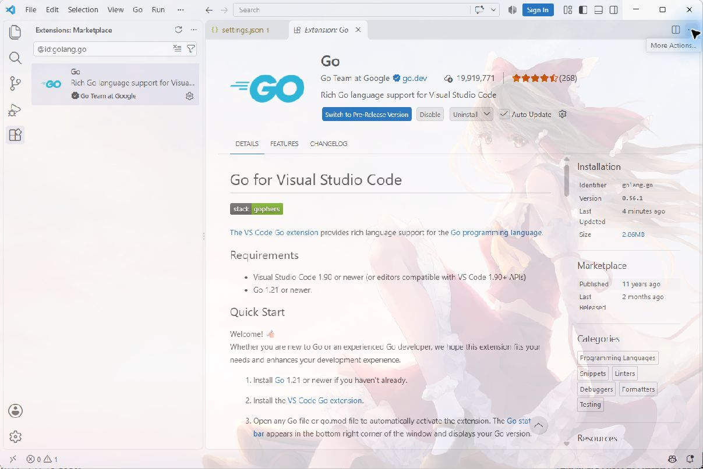
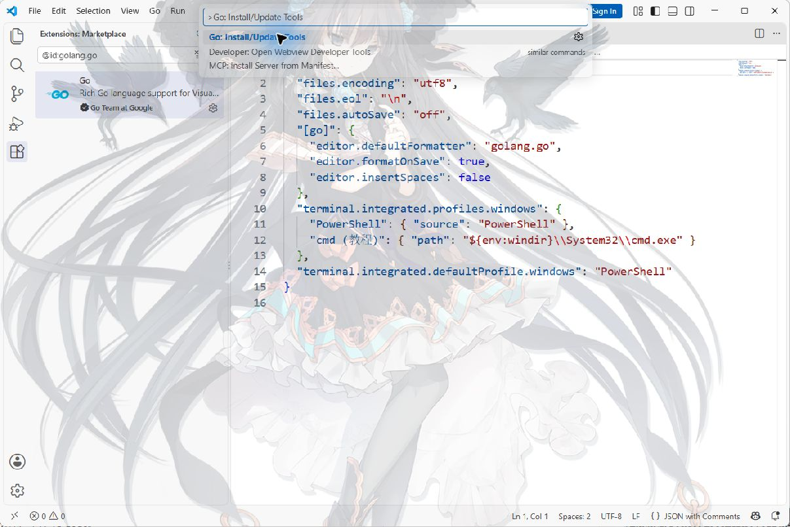
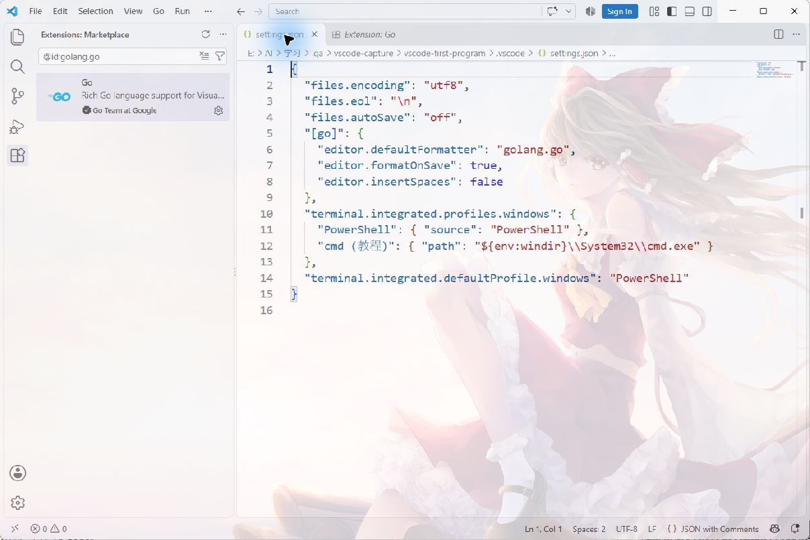
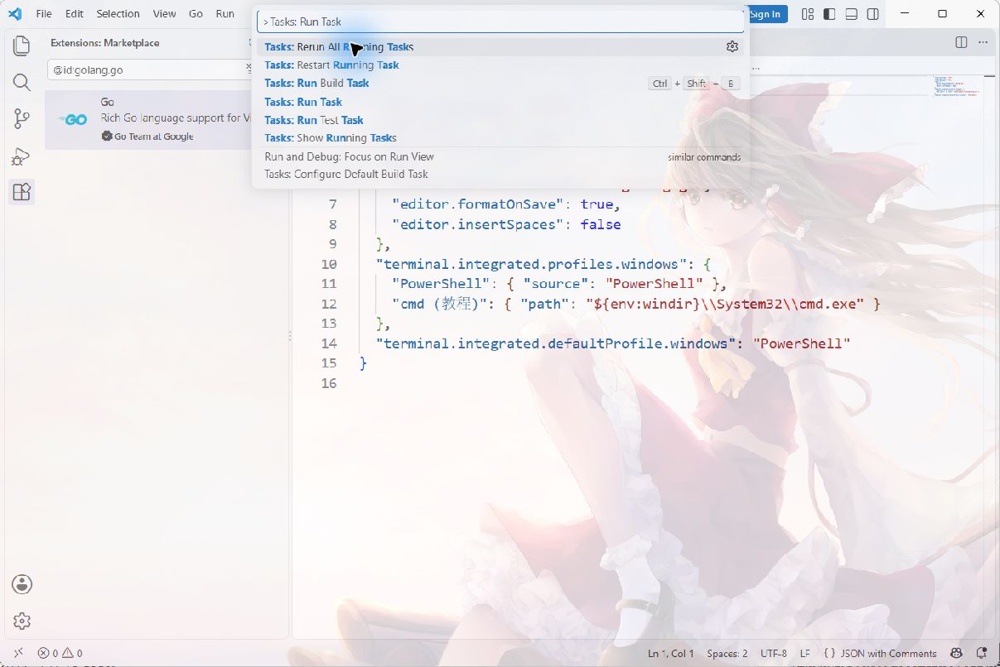

# 安装 VS Code，认识你的工作区

先完成这四步：下载编辑器 → 打开练习文件夹 → 新建并保存文件 → 打开终端。已有环境可以直接进入 Web 或 Go 教程，用运行结果自查。

请在 Windows、macOS 或 Linux **电脑**上完成操作；手机可以阅读，不能照本教程安装桌面版 VS Code。先选一条路线：想做网页选 Web，想写 Go 程序选 Go；两条不用同时配置。不确定时先做 Web，保存一个文件就能看到结果。

## 1. 从哪里下载

打开 [VS Code 官方下载页](https://code.visualstudio.com/download)，选择与你的系统和处理器匹配的稳定版本。VS Code 是写代码的编辑器，浏览器负责显示网页，Go 工具链负责运行 Go；安装编辑器不等于装齐所有语言环境。

- **Windows**：在“设置 → 系统 → 系统信息（或关于）”查看系统类型：x64 处理器选 x64，ARM 处理器选 Arm64。普通个人电脑选 **User Installer**。在浏览器下载列表或“下载”文件夹找到 `.exe`，双击，阅读并接受协议，按 Next（下一步）继续；保留添加到 PATH 的选项，选择 Install（安装）→ Finish（完成）。从开始菜单打开 Visual Studio Code。不要误装名称相近的 Visual Studio。[Windows 官方安装说明](https://code.visualstudio.com/docs/setup/windows)
- **macOS**：在苹果菜单“关于本机”查看芯片，Apple M 系列选 Apple Silicon，Intel 选 Intel；也可选 Universal。打开下载的 `.dmg`，把 Visual Studio Code 拖到 Applications（应用程序），再从应用程序中打开。[macOS 官方说明](https://code.visualstudio.com/docs/setup/mac)
- **Linux**：按发行版选择安装包，Debian/Ubuntu 使用 `.deb`，Fedora 等使用 `.rpm`；按官方页面对应发行版步骤安装。[Linux 官方说明](https://code.visualstudio.com/docs/setup/linux)

本教程用编辑器的基本功能，不要求登录账号或购买 AI 服务。[VS Code 起步说明](https://code.visualstudio.com/docs/getstarted/overview)

**打开后全是英文？** 按 `Ctrl+Shift+P`（Mac 为 `Cmd+Shift+P`）打开“命令面板”：它是顶部弹出的功能搜索框，不是底部终端。输入 `Configure Display Language` 并选中，选择简体中文或繁体中文，按提示安装语言包并重启；也可继续对照本文中英菜单操作。[显示语言说明](https://code.visualstudio.com/docs/configure/locales)

**到这里应该看到**：VS Code 的欢迎页和顶部菜单。若提示系统不支持、权限不足或安装失败，记下系统类型、安装包文件名、完整提示，先到“学会问 AI”整理问题，不要把安装失败当作不会写代码。

PATH 是系统查找命令的目录列表。本节不需要手动编辑它，也不要求能在终端运行 `code`；从应用图标打开即可。

## 2. 先打开文件夹，再写文件

1. 已有本仓库文件夹可直接用。只有在线网页时，打开 [本教程的 GitHub 仓库](https://github.com/zhouwu97/web-kaifa)，点击 **Code → Download ZIP**。Windows 右键 ZIP 选“全部解压缩”，Mac 双击解压；不要在 ZIP 预览窗口里修改。此方式不要求先安装 Git。
2. 找到解压后同时含有 `README.md`、`index.html`、`exercises` 的那层文件夹；它就是**仓库根目录**（整套资料的最外层，不是电脑的 C 盘根目录）。在 VS Code 选择 **File → Open Folder（文件 → 打开文件夹）**，选中这一层。
3. 下载暂时打不开也能练习：在“文档”中新建 `my-learning`，用 VS Code 打开它，再在左侧分别新建 `exercises`、其下的 `web` 或 `go` 文件夹。后面所说的根目录就是 `my-learning`；不要把 `exercises/web` 整串当成一个文件夹名。
4. 点击左侧资源管理器（文件图标），展开 `exercises`，再展开所选方向 `web` 或 `go`。右键该方向文件夹 → **New Folder（新建文件夹）**，输入 `setup-check`。目录已存在且有旧作品时改用 `setup-check-2`，后续路径也相应替换。
5. 右键刚建的练习文件夹 → **New File（新建文件）**。Web 路线命名 `index.html`，Go 路线命名 `main.go`。先保存空文件即可，下一篇会提供完整代码；不要改仓库根目录那个同名的 `index.html`，那是学习网站。

看到工作区信任提示时，只对自己创建或已经检查来源的文件夹选择信任。教程中的路径都是仓库相对路径，实际位置以你自己电脑为准。

按 Windows/Linux 的 `Ctrl+S` 或 macOS 的 `Cmd+S` 保存。用菜单“文件 → 保存”也可以。文件标签上的小圆点通常表示未保存。**到这里应该看到**：文件位于自己新建的练习目录里，而不是一个叫 Untitled（未命名）的临时标签。

## 3. 认识三个位置

| 位置 | 用来做什么 | 这里应该输入什么 |
| --- | --- | --- |
| 左侧资源管理器 | 管理文件和文件夹 | 选择或新建文件 |
| 中间编辑区 | 写程序并保存 | HTML、CSS、Go 源码 |
| 底部终端 | 执行命令并查看输出 | `go version` 等命令 |

用菜单 **Terminal → New Terminal（终端 → 新建终端）** 打开终端。Windows 本教程使用 PowerShell；若终端显示 cmd 或其他 shell，可在终端下拉菜单选 PowerShell。macOS/Linux 通常使用 zsh/bash。[终端官方说明](https://code.visualstudio.com/docs/terminal/basics)

终端提示符可能长这样：`PS C:\某个目录>`。它表示当前位置，不是让你一起复制的命令。输入下面这一行查看当前文件夹：

```powershell
pwd
```

预期：输出当前目录。与左侧练习文件夹不一致时，先用 `cd "你的实际路径"` 进入；路径有空格时保留引号。不要照抄这句占位路径。

更容易的方法是：在左侧**右键练习文件夹** → **Open in Integrated Terminal（在集成终端中打开）**，再输入 `pwd`，应以 `exercises/web/setup-check` 或 `exercises/go/setup-check` 结尾。Windows 显示反斜杠 `\` 也正常。找不到此菜单时，先用“打开文件夹”直接打开练习文件夹，再新建终端。

每次复制一条命令，点击终端光标处粘贴并按 **Enter（回车）**；等待输出和新的提示符出现，再输下一条。不要复制代码框边界、`PS …>`、`$` 或“预期输出”。终端用于运行命令，文件用于保存代码，网站里的练习框与本机文件也不会自动同步。

## 4. 写下代码之后，究竟发生了什么

写代码并不是在编辑器里打完字就自动执行。先把这条过程看清：**编辑区里的文字 → 保存到磁盘上的文件 → 交给对应工具读取 → 在浏览器或终端观察结果**。任何一步没完成，后面的结果都可能还停在旧版本。

例如，你在 VS Code 把网页标题从“你好”改成“我的主页”，这时改变的是编辑器里的内容。按保存，磁盘上的 `index.html` 才更新；浏览器刷新，才会重新读取这个文件。Go 也类似：修改 `main.go`、保存，然后重新运行 `go run .`，才会编译并执行新的代码。**保存、编译、运行是不同动作**。

可以把 VS Code 窗口理解为下面的分工。这是位置示意，不是要求界面必须长得完全一样：

```text
顶部菜单：文件 / 编辑 / 查看 / 终端
左侧文件区         中间编辑区
setup-check        main.go 或 index.html
  main.go          在这里输入源代码，然后保存
  go.mod
                   底部面板 → 终端
                   在这里输入 go run . 并看输出
```

“源代码”就是你写给工具读取的文字。文件后缀帮助工具识别语言：`.html` 是网页文档，`.go` 是 Go 源文件。它们都是文本，但处理方法不同；不能把 `go run .` 写进 HTML，也不能把 HTML 标签直接当作终端命令。

| 要做的事情 | VS Code 中先做什么 | 接下来在哪里看结果 |
| --- | --- | --- |
| 写第一张 HTML 网页 | 编辑并保存 `index.html` | 用浏览器打开文件，看页面；修改后保存、刷新 |
| 运行 Go 程序 | 编辑并保存 `main.go`，在正确目录终端输入 `go run .` | 同一个终端里看打印文字与报错 |
| 生成能单独启动的 Go 程序 | 在终端执行本教程后面的 `go build` 命令 | 文件区出现可执行文件，再在终端启动它 |
| 找到编辑器的功能 | 打开顶部命令面板并搜索功能名 | 编辑器界面发生变化，不是程序运行结果 |

右上角三角形按钮的行为取决于当前语言、扩展和配置。第一次学习先用教程给出的明确命令；当你知道运行了哪个文件、结果在哪里，再学习快捷运行与调试。无需为了找到一个“运行”按钮安装多套运行插件。

## 5. 跟着做一次编辑、保存、重开

这一小节先不编译程序，只确认你掌握文件操作。右键自己的 `setup-check` 文件夹，新建 `practice.txt`，输入下面两行：

```text
今天我开始学习编程。
我会先保存，再检查结果。
```

按保存，再关掉这个文件的编辑标签。**关标签只关闭视图，不删除文件**。从左侧重新点开 `practice.txt`，如果两句话还在，说明文件确实保存在这个目录中。若关标签时询问是否保存，选保存后再继续。

接下来把第二句改成“我知道自己的文件在哪里”。改错了可按 `Ctrl+Z`（Mac 为 `Cmd+Z`）撤销刚才的编辑；确认文字后再保存。想找到一句话，按 `Ctrl+F`（Mac 为 `Cmd+F`）输入关键词。想快速打开某个文件，用 `Ctrl+P`（Mac 为 `Cmd+P`）输入文件名。第一次不必背快捷键，也可以用顶部菜单。

**用自己的话回答**：关掉 VS Code 再打开，文件为什么还在？因为保存把文字写入了磁盘；编辑标签不是文件本身。网站中的代码草稿保存在浏览器里，和这些本机文件是两套存储，不能以为其中一处的修改会自动同步到另一处。

## 6. 学会读终端的一次对话

终端不是只能看不能输入的黑框。它接受命令，显示工具回应，然后等待下一条。下面是 Windows PowerShell 的示意，路径要以自己电脑为准：

```output
PS C:\my-learning\exercises\go\setup-check> go version
go version go1.x.y windows/amd64
PS C:\my-learning\exercises\go\setup-check>
```

第一行的 `PS …>` 是终端已经显示的提示符，你只输入 `go version`。第二行是 Go 工具的输出，**不需要再输入一次**。最后又出现提示符，说明这条命令结束了。这里 `go1.x.y` 是格式说明，不是要求安装这个字面版本。

| 命令 | 意思 | 怎么判断结果 |
| --- | --- | --- |
| `pwd` | 显示终端当前所在目录 | 路径末尾应是你这次的练习文件夹 |
| `ls` | 列出这个目录的文件 | Go 练习应能找到 `main.go`、`go.mod` |
| `cd ..` | 切换到上一级目录 | 再执行 `pwd`，路径会少最后一层 |

这些命令适用于本教程使用的 PowerShell 或 macOS/Linux 的 zsh/bash。`cd` 只改变**当前终端**的位置，不会自动切换编辑器打开的文件。若你在编辑 `main.go`，但终端在另一个目录，`go run .` 就会运行另一个目录的包；这也是为什么教程每次强调核对位置。

看到服务器持续打印日志、没有新的提示符，通常表示它还在运行。需要结束时按 `Ctrl+C`。不要因为它没退出就在后面反复输入其他命令；可以在终端区域点加号开一个新终端。

## 7. 遇到这些情况先查哪里

| 现象 | 先做的检查 | 还不行时带给 AI 的证据 |
| --- | --- | --- |
| `code` 不是命令 | 重开终端；也可从开始菜单打开 VS Code，然后用“打开文件夹” | 系统、安装方式、完整报错；不用为此暂停 Web 学习 |
| 文件在编辑器里有，磁盘上找不到 | 检查是否保存、是否开错文件夹、是否仍在 ZIP 中 | 工作区相对目录与文件名 |
| 文件名成了 `index.html.txt` | 系统文件管理器显示扩展名；重新确认文件名 | 完整文件名，不只看图标 |
| 不知道命令在哪里输入 | 先打开“终端 → 新建终端”，不要把命令贴进源码 | 终端类型、`pwd` 输出（个人路径可打码） |
| 终端打不开，显示 Restricted Mode（受限模式） | 检查当前文件夹是否是自己创建或已核实来源的目录，再决定工作区信任 | 工作区路径、信任提示；不要盲目信任陌生项目 |

**自查结果**：你能找到并保存一个文件，能说出当前终端在哪个目录。然后选择“Web 环境”或“Go 环境”。阅读教程不会自动完成课程。

## 8. 安装 Go 插件：要找哪一个，装完还缺什么

这一节到第13节给 **Go 路线**。Web 用户先去“Web 环境”运行 HTML；内置 HTML/CSS/JavaScript 支持已经可以编辑第一张网页，后续框架项目按各阶段 README 安装依赖。不要为了网页运行而装 Go 插件。

Go 的四个角色先分清：**Go SDK** 提供 go 命令与编译器；**Go 扩展** 把编辑器接到这些工具；**gopls** 提供补全、跳转和诊断；**dlv（Delve）** 负责断点调试。只装扩展不会得到一个完整 Go SDK；`go run .` 能运行也不代表 dlv 已安装。

1. 确认“Go 环境”中的 `go version` 已成功。安装 Go 官网当前受支持的补丁版本，不照截图固定安装旧版。
2. 在 VS Code 左侧点击四小块的 **Extensions（扩展）** 图标；或按 `Ctrl+Shift+X`，Mac 用 `Cmd+Shift+X`。
3. 在扩展搜索框输入 **`@id:golang.go`**，点击名称 **Go**、发布者 **Go Team** 的条目，核对唯一标识 `golang.go`。在这里输入搜索词，不在底部终端输入。
4. 点击 **Install（安装）**，等按钮变成管理齿轮、Disable/Uninstall（禁用/卸载）等已安装操作。若已经安装无需重复；若提示 Reload Window（重新加载窗口），按提示重新加载。只有核实发布者与来源后才接受对应信任提示。[Go 扩展官方入口](https://marketplace.visualstudio.com/items?itemName=golang.go)
5. 打开 `main.go`，右下角语言模式应显示 **Go**。若是 Plain Text（纯文本），点击语言名称选择 Go，确认文件名真的是 `main.go`，不是 `main.go.txt`。
6. 按 `Ctrl+Shift+P`，在**顶部命令面板**搜索 **`Go: Install/Update Tools`**，回车；勾选 **gopls** 和 **dlv**，点击 OK。等待下载与构建完成，到底部“输出”面板选择 **Go**，检查成功或完整错误；不要只看安装按钮点过没有。



图是实际 VS Code 截图，审核机已经安装，所以出现卸载/禁用按钮；新安装时对应位置是 Install。界面语言和主题可以不同，认清扩展 ID 与操作位置即可。可选中文语言包搜索 `MS-CEINTL.vscode-language-pack-zh-hans`（Microsoft）；它只翻译编辑器菜单，不翻译你的程序输出。



**工具下载失败怎么处理？** 先复制 Go 输出面板里的工具名、失败命令和错误，再记录 `go version`。Go SDK 找不到时彻底关闭、重新打开 VS Code，让它读取新 PATH；SDK 能用但工具下载超时属于网络/工具安装问题。不要重复安装多套 Code Runner、全局乱改代理或关闭证书校验。若只想先看到结果，继续用 `go run .`；稍后再修补全或调试工具。[扩展安装与管理](https://code.visualstudio.com/docs/configure/extensions/extension-marketplace)

### 看到 The "dlv" command is not available，具体怎么做

这条提示表示编辑器没有找到 **调试工具**，不表示 main.go 语法有错。通知右下角的 **Install** 可以安装缺少的 dlv；也可以用上面的 `Go: Install/Update Tools` 勾选 dlv 安装。安装期间等待 Go 输出面板，只有明确成功后才重试 F5。通知消失本身不是成功证据。

若命令面板方式失败，官方提示也给出手工安装命令。下面一行在 **VS Code 终端** 执行，不放进 main.go 或 JSON；它从 Go 模块来源下载并构建 Delve，可能需要联网：

```powershell
go install -v github.com/go-delve/delve/cmd/dlv@latest
```

成功时可能打印包名，也可能没有额外文字；失败时保留从失败命令到最后一行的完整输出。安装完成后用下面命令查看 Go 工具放在哪里（不是要求你另建这些目录）：

```powershell
go env GOBIN GOPATH
```

GOBIN 有值时工具放那里；为空时通常是 GOPATH 下的 bin。不要把 `go env GOPATH` 的路径整体当作 dlv.exe 文件。重新打开 VS Code，用命令面板 **Go: Locate Configured Go Tools** 查看编辑器实际找到的 dlv 路径；若终端能安装但编辑器仍找不到，先查这里，再针对实际工具目录修 PATH。初学者优先让 Go 扩展的安装功能处理路径；手工安装不需要覆盖整条 PATH 或设置一个猜测的 GOROOT。

`fmt` 下红线怎么查？鼠标悬停红线，或菜单 View → Problems（查看 → 问题）读取完整诊断；确认独立项目已有 go.mod、main.go 已保存、gopls 已安装，再用终端 `go run .` 区分编译器错误与编辑器诊断。只看到 main.go 而没看到 go.mod 时先按第9节建立模块；已有模块不重复初始化。编译成功但红线未更新，可用命令面板 **Go: Restart Language Server** 刷新语言服务。不要因 fmt 是红色就另装一个名叫 fmt 的插件。

## 9. 打开正确项目，建立 .vscode 文件夹

最稳妥的跟做方式：**[下载完整 Go 起步包](../../assets/downloads/vscode-go-starter.zip)** → 全部解压缩 → VS Code“文件 → 打开文件夹” → 选择解压后的 **`vscode-first-program`**。它已有源码、模块和四个配置，不需要再初始化。这个独立例子不会覆盖你已写的程序。

手工跟做分成三个步骤，**不要在只有 main.go 的时候直接按 F5**。项目文件夹已经存在时保留原代码，不必重复新建。

**第一步：创建并打开独立目录。** 新建 `vscode-first-program`，VS Code“文件 → 打开文件夹”选择它。资源管理器右键最上方项目名 → 在集成终端中打开。cmd 输入 `cd`/`dir`，PowerShell 输入 `Get-Location`/`Get-ChildItem`，Mac/Linux 输入 `pwd`/`ls`，确认终端位置。

**第二步：建立 Go 模块。** 先在终端执行 `go env GOMOD`：已有模块路径就沿用，并打开对应模块根目录；没有模块且这是你要独立创建的项目，才执行下面一条。下载起步包的人已有 go.mod，直接跳过。

```sh
go mod init example.com/learn/vscode-first-program
```

预期显示 `go: creating new go.mod: module example.com/learn/vscode-first-program`，文件区新增 go.mod；再次 `go env GOMOD` 应指向它。初始化只在新项目做一次，**不在整个教材资料根目录执行**。go.mod 定义项目模块，`.vscode` 定义编辑器行为，两个文件承担不同职责，装插件或新建 .vscode 不会代替模块初始化。

**第三步：保存源码并先验证运行。** 新建 main.go，把下面完整内容粘贴并保存。在同一个终端执行 `go run .`，看到两行正确问候后，才建立后面的四个编辑器配置。已有第1课源码可以直接保留运行，不要求为了配置而覆盖它。

```go
package main

import "fmt"

func greeting(name string) string {
	return "你好，" + name
}

func main() {
	name := "Go"
	message := greeting(name)
	fmt.Println(message)
	fmt.Println("编译后的程序也能独立运行")
}
```

先核对 `go run .` 的预期结果：

```output
你好，Go
编译后的程序也能独立运行
```

此时项目只有 main.go 和 go.mod 就可以运行。运行成功，再完成后面的四个配置后，最终目录应是：

```text
vscode-first-program/       ← VS Code 打开的文件夹
  main.go                  ← 你的源码
  go.mod                   ← Go 模块信息
  .vscode/                 ← 本项目的编辑器配置
    settings.json
    tasks.json
    launch.json
    extensions.json
```

这里 `${workspaceFolder}` 是 VS Code 的变量，会被替换为**当前打开的文件夹路径**，不是让你新建同名文件夹。如果打开的是整套学习资料，配置放在 `exercises/go/.../.vscode`，任务可能找不到；本教程直接打开独立 Go 项目，避免这个层级问题。文件名不能写成 `tasks.json.txt`；每个文件只贴它自己的一个完整 JSON，不贴 Markdown 的三反引号。

VS Code 有“用户设置”和“工作区设置”。本教程的 `.vscode/settings.json` 只作用于这个项目；不要为了一个练习去覆盖所有项目的用户设置。已有配置先保留或备份，合并键值，不把两个 `{ ... }` 并排贴在同一个文件；JSON 的引号用英文双引号，逗号放在相邻项之间。

运行验证成功后，资源管理器右键项目名 → 新建文件夹，命名 **`.vscode`**（保留开头的点），再在它下面新建第10–12节的四个 JSON；把每份完整配置放进对应文件并保存。**还在报 go.mod file not found？** [直接查看缺模块修复步骤](../../index.html#/setup?topic=go&step=missing-module)，完成模块与运行检查，再回来继续配置。

## 10. settings.json：选终端与保存格式

打开 `.vscode/settings.json`，完整粘贴并保存：

```json
{
  "files.encoding": "utf8",
  "files.eol": "\n",
  "files.autoSave": "off",
  "[go]": {
    "editor.defaultFormatter": "golang.go",
    "editor.formatOnSave": true,
    "editor.insertSpaces": false
  },
  "terminal.integrated.profiles.windows": {
    "PowerShell": { "source": "PowerShell" },
    "cmd (教程)": { "path": "${env:windir}\\System32\\cmd.exe" }
  },
  "terminal.integrated.defaultProfile.windows": "PowerShell"
}
```

| 配置 | 实际作用 | 如何观察 |
| --- | --- | --- |
| files.encoding / files.eol | 新文件使用 UTF-8、LF | 底部状态栏显示 UTF-8 与 LF，中文输出不会因文件编码混乱 |
| files.autoSave: off | 练习时明确手动保存 | 修改后标签出现未保存点，Ctrl/Cmd+S 后消失 |
| [go] 的 defaultFormatter / formatOnSave | 用 Go 扩展格式化 Go 文件，保存时整理缩进 | 故意乱缩进后保存，gopls 安装成功时格式整理；格式化不是自动运行 |
| terminal 的 profiles / defaultProfile | Windows 默认新终端使用 PowerShell | 关闭旧终端，再“终端 → 新建终端”，下拉列表应选中 PowerShell |



**默认终端改了，旧 cmd 还在？** 这是正常的：设置只影响新终端。先停止旧终端正在运行的程序，再点终端垃圾桶关闭这一终端，重新新建；若默认配置不能识别已安装的 PowerShell，按 `Ctrl+Shift+P` → **Terminal: Select Default Profile（终端：选择默认配置文件）**，选实际列出的 PowerShell，再新建。macOS/Linux 不应用 `*.windows` 设置，保留系统 zsh/bash 即可。

| 你现在看到的终端 | 查看当前目录 | 查看文件 | Windows hello.exe / Unix hello 的启动方式 |
| --- | --- | --- | --- |
| PowerShell，通常有 `PS C:\...>` | `Get-Location` 或 `pwd` | `Get-ChildItem` 或 `ls` | `.\hello.exe` |
| cmd，通常只有 `C:\...>` | `cd`（不带参数） | `dir` | `hello.exe` 或 `.\hello.exe` |
| macOS/Linux zsh/bash | `pwd` | `ls` | `./hello` |

截图中 cmd 输入 `./hello.exe` 报“`.` 不是内部或外部命令”，先改成 cmd 的启动写法，**不需要修改 Go 函数或重装编辑器**。还报找不到 hello.exe 时检查是否构建成功和当前目录；`go run .` 能成功时也可以先用它继续学。

## 11. tasks.json：用菜单运行，用快捷键编译

打开 `.vscode/tasks.json`，完整粘贴并保存：

```json
{
  "version": "2.0.0",
  "tasks": [
    {
      "label": "Go: 运行当前项目",
      "type": "process",
      "command": "go",
      "args": ["run", "."],
      "options": { "cwd": "${workspaceFolder}" },
      "problemMatcher": ["$go"],
      "presentation": { "reveal": "always", "panel": "dedicated", "clear": true }
    },
    {
      "label": "Go: 编译当前项目",
      "type": "process",
      "command": "go",
      "args": ["build", "-o", "${workspaceFolder}/hello.exe", "."],
      "linux": { "args": ["build", "-o", "${workspaceFolder}/hello", "."] },
      "osx": { "args": ["build", "-o", "${workspaceFolder}/hello", "."] },
      "options": { "cwd": "${workspaceFolder}" },
      "group": { "kind": "build", "isDefault": true },
      "problemMatcher": ["$go"]
    },
    {
      "label": "Go: 编译并运行",
      "type": "process",
      "command": "${workspaceFolder}/hello.exe",
      "linux": { "command": "${workspaceFolder}/hello" },
      "osx": { "command": "${workspaceFolder}/hello" },
      "dependsOn": "Go: 编译当前项目",
      "dependsOrder": "sequence",
      "options": { "cwd": "${workspaceFolder}" },
      "problemMatcher": [],
      "presentation": { "reveal": "always", "panel": "dedicated", "clear": true }
    }
  ]
}
```

任务就是给 VS Code 保存一组明确命令。`label` 是菜单里的名字，`command` 是执行的工具，`args` 是传给工具的参数，`cwd` 是工作目录。这里 `type: process` 直接启动工具，避免 cmd/PowerShell 对斜杠和引号的解释差异；配置不会在粘贴或保存时自动执行。

三个任务分别做什么：**运行当前项目**执行 `go run .`；**编译当前项目**只生成 hello.exe（Windows）或 hello（Mac/Linux）；**编译并运行**先成功编译，再启动新的程序。`dependsOn` 建立先后关系，构建失败时不会当成新程序成功运行；不用手动记“改了源码还要重建旧 exe”。Windows 路径含空格也交给进程参数处理，不需要自己拼一串引号。配置不指定你电脑的 GOROOT 或某个固定 C 盘路径。

现在真的运行一次：

1. 打开并保存 `main.go`。按 `Ctrl+Shift+P`（Mac 为 Cmd+Shift+P），搜索 **Tasks: Run Task（任务：运行任务）**。用上下箭头或鼠标选中**准确名称 Tasks: Run Task** 再回车；搜索结果第一项可能是 Rerun All Running Tasks，不要只看搜索词就直接回车。
2. 从列表选 **Go: 运行当前项目**，回车。若询问扫描任务，选择本工作区已有任务；只有核实自己创建的配置后才运行。
3. 结果出现在底部 **Terminal（终端）**，应有下面两行。任务结束的说明和 Go 输出分开看；短程序打印后退出是正常现象。
4. 把 `name := "Go"` 改成 `name := "小林"`，保存，再运行同一任务，第一行应变成“你好，小林”。这才证明你跑了自己的新代码。
5. 按 **Ctrl+Shift+B**（Mac 为 Cmd+Shift+B）执行默认编译任务，成功时项目文件区出现 hello.exe/hello，**不会自动显示问候**。再用运行任务菜单选择 **Go: 编译并运行**，确认显示新的问候。

```output
你好，Go
编译后的程序也能独立运行
```



本图展示功能入口，不是终端命令。图中默认高亮第一项 **Rerun All Running Tasks**；本教程需要选择第4项 **Tasks: Run Task** 再回车，列表顺序随版本可能变化，应按准确名称选择。找不到三个 Go 任务时先核对项目层级、文件名与 JSON 语法，不继续在根目录随处粘贴配置。出现 `go` 找不到时检查 SDK/PATH；出现 `go.mod file not found` 时核对 cwd 目录；出现源码错误时先修具体文件行号，再重跑。右上角来源不明的三角按钮可能由其他扩展提供，先使用这里名字明确的任务。

### extensions.json：推荐插件，不替用户自动安装

`.vscode/extensions.json` 完整内容：

```json
{
  "recommendations": ["golang.go"]
}
```

它告诉打开此项目的人“推荐 golang.go”。推荐列表不是已安装列表，也不会把 gopls、dlv 自动装齐；第8节的安装和验收仍要做。分享项目时可带这份推荐文件；本仓库的个人 `.vscode` 默认不提交，配置源单独保存在 docs，下载包已组合好。

## 12. launch.json：F5 调试，停下来观察变量

**按 F5 前确认三项**：这个独立项目有生效的 go.mod；同目录 `go run .` 已成功；Go 扩展和 dlv 已可用。前两项没完成时，先回第9节准备项目。F5 报模块找不到时，处理的是项目准备；再次安装 dlv 不能创建 go.mod。

打开 `.vscode/launch.json`，完整粘贴并保存：

```json
{
  "version": "0.2.0",
  "configurations": [
    {
      "name": "Go: 调试当前项目",
      "type": "go",
      "request": "launch",
      "mode": "debug",
      "program": "${workspaceFolder}",
      "cwd": "${workspaceFolder}",
      "console": "internalConsole"
    },
    {
      "name": "Go: 调试需要输入的程序",
      "type": "go",
      "request": "launch",
      "mode": "debug",
      "program": "${workspaceFolder}",
      "cwd": "${workspaceFolder}",
      "console": "integratedTerminal"
    }
  ]
}
```

`type: go` 选择 Go 扩展的调试器；`request: launch` 表示启动新的调试程序；`mode: debug` 由调试器构建当前源码；`program` 与 `cwd` 都使用当前独立项目。调试不是继续启动你昨天编译的 hello.exe，也不需要先点击“编译”才 F5。[Go 扩展官方调试说明](https://github.com/golang/vscode-go/blob/master/docs/debugging.md)

### A. 保留 Go 第1课的最小源码

新版第1课只有 `fmt.Println("你好，Go")`。在这行按F9设置断点，再按F5，程序应在打印前暂停。main还没有name/message，变量面板没有它们正常；按F10执行这条打印，再继续结束。

这个例子不定义greeting函数，不要求进入不存在的函数。已有旧草稿含greeting时，按自己的实际源码设置断点；想学习参数与局部变量，先学函数和作用域，再用下面第9节的完整示例。

### B. 使用第9节的变量示例，观察 name 和 message

下面六步对应第9节完整源码中的 `name := "Go"`、`message := greeting(name)` 和 `fmt.Println(message)`。先核对文件确实包含这些语句，再照做；两份程序不同，不代表变量和断点位置相同。

1. 按 `Ctrl+S` 保存 `main.go`，确定第8节 dlv 安装成功。左侧点击 **Run and Debug（运行和调试，带小虫的三角图标）**，顶部下拉选择 **Go: 调试当前项目**。
2. 在 `fmt.Println(message)` 这一行点行号左侧空白区域，或把光标放该行按 **F9**；应该出现红色断点点。笔记本功能键需 Fn 时按 Fn+F9，也可用 Run 菜单的 Toggle Breakpoint（切换断点）。
3. 按 **F5**（或 Run → Start Debugging）。第一次若提示 dlv 缺失，先安装对应工具，完成后重新 F5；不要把这一提示当成源码错误。
4. 程序应在这一行**执行之前暂停**，有当前行标记。左侧 **Variables（变量）** 展开 Locals，可看到 `name` 为 Go、`message` 为“你好，Go”；若前一节改成小林，这里也应对应变化。
5. 按 **F10**（Step Over，逐过程）执行这一行，在底部 **Debug Console（调试控制台）** 看到问候；再 F10 执行第二行。F5 是继续执行到下一个断点或结束，**Shift+F5** 停止。
6. 想看 greeting 内部，把断点设在 `message := greeting(name)`：F5 暂停，**F11**（Step Into，单步进入）进入 greeting，看参数，**Shift+F11**（Step Out，单步跳出）返回调用者。每次只用一个动作，观察当前行与变量变化。

| 现象 | 先检查什么 |
| --- | --- |
| F5 要求选择环境，没有 Go | Go 扩展是否已启用、是否在自己的项目、launch.json 是否保存 |
| Could not find dlv / failed to launch | Go 输出面板里是否有 dlv 安装失败、SDK/工具路径是否可用 |
| 断点空心或没停 | 断点是否在会执行的语句上、源码是否保存、是否启动了这个项目，而不是注释/空白/另一个目录 |
| Variables 看不到局部值 | 程序是否真正暂停、是否选中 main 的调用栈帧 |
| 程序输出到 Debug Console | 这是第一个配置指定的输出位置，不需要去 Output 面板找 |

### fmt.Scan 程序需要输入：换第二个调试配置

第一个配置的 internalConsole 用来查看调试输出，**不提供程序的标准输入**。跟“Go 环境”的输入程序做 fmt.Scan 时，选 **Go: 调试需要输入的程序** 再 F5，在底部 **Terminal** 中输入称呼、回车；不要往 Debug Console 表达式框输入名字。Go 扩展目前把 integratedTerminal 调试列为实验能力，遇到兼容性问题先用 `Go: 运行当前项目` 任务或终端 `go run .` 验证输入，再带 Go/扩展/dlv 版本排查调试。

## 13. 做完自查，并把真正的问题交给 AI

不要以“我粘贴过配置”作为完成标准。依次验证：插件 ID/安装状态正确；gopls/dlv 的输出明确成功；独立文件夹中有四个 JSON；任务运行显示两行；改名保存后输出变化；编译生成文件；F5 断点暂停，能看到 message。哪一步失败就停在那一步记录证据，不重复乱装所有环境。

下面是排错时自己填写的文字模板，**不是 AI 已给出的回复**。个人用户名、密码、令牌和私有路径可以打码；保留路径层级、终端类型与错误原文：

```text
我在 Windows 的 VS Code 学 Go，当前终端是 cmd/PowerShell（填写实际类型）。
目标：运行 vscode-first-program 的问候程序。
工作区文件树：main.go、go.mod、.vscode 下四个 JSON（填写自己的实际目录）。
环境：go version 的实际输出；Go 扩展版本；gopls/dlv 安装成功或失败的原文。
执行动作：Tasks: Run Task → Go: 编译并运行（或自己的完整命令）。
预期：终端显示“你好，Go”和“编译后的程序也能独立运行”。
实际：粘贴完整报错与终端提示符，说明输出出现在哪个面板。
已尝试：我检查并保存 main.go，确认当前目录有 go.mod；写出实际结果。
请先判断卡在终端写法、工作区路径、插件工具还是源码，给一个最小检查步骤。
不要直接重写整个项目；解释为什么这样查，以及正常时应该看到什么。
```

得到建议后，每次只改一处，保存并重新验证同一操作，把“失败原文 → 修改 → 实际成功输出”写入笔记。生成或复制问题不会替你完成课程。调试理解的是程序怎么走到结果；运行正确一次以后，还要用自己的输入和边界检验。

官方链接核对日期：2026-10-13。菜单语言、安装界面可能随版本变化，出现差异时对照官方说明与实际界面。
